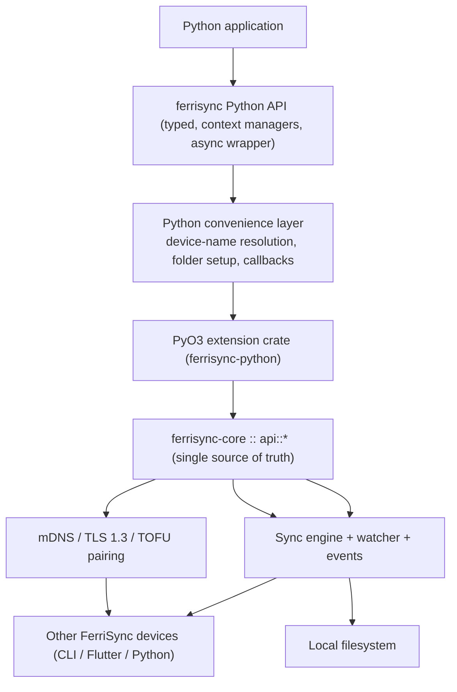

# Implementation plan: Python library for FerriSync

Status: reviewed against `v0.1.0` / `8a74a66`, then updated for the
`fix_release` hardening series through `1481748` (2026-11-20).
Originally drafted in `ideas/`; promoted to this tracked plan document.

## Implementation status (branch `fix_release`, 2026-11-20)

Landed in core/Python and CI/docs:

- `ferrisync-python` workspace member with PyO3/maturin package, sync `Client`,
  `AsyncClient`, `Watcher`/`AsyncWatcher`, typed helpers, examples, tests, and
  type stubs.
- Core `api::start_server_with_policy(..., auto_accept)` exposed; Python
  `serve(..., auto_accept=...)` wired. FRB gated in core for non-Flutter builds.
- Folder server registry moved into `ApiState` (per-instance ownership) and
  `stop_server`/`close` scoped to the instance.
- Event delivery refactored to mpsc ingress + broadcast fanout with persistent
  polling (`poll_sync_events`, `subscribe_sync_events`).
- Core watch lifecycle APIs: `start_watch`, `stop_watch`, `list_watches`,
  `stop_all_watches`, and `close` stops servers+watches.
- Deep cooperative cancellation: `SyncCancelToken` is threaded through
  connect/handshake/chunk/finalization paths; core API variants
  (`sync_folder_with_cancel`, `start_watch_with_cancel`) delegate from the old
  signatures. Python exposes `sync(..., cancel=...)`, `watch(..., cancel=...)`,
  `FerriSyncCancelledError`, and async `CancelledError` translation. A cancelled
  call raises instead of returning stale results; files committed before
  cancellation remain valid for reconciliation on the next sync.
- `AsyncClient` uses a bounded thread-pool executor and supports cooperative
  cancellation signaling.
- Typed exception mapping includes `FerriSyncError`, `ClientClosedError`,
  `FerriSyncCancelledError`, `InvalidArgumentError`, and `NotFoundError`.
- Python tests added/strengthened: shared harness, CLI interop, reliability and
  same-port kill/restart scenarios, conflict-backup and unsafe-path assertions,
  empty-directory behavior, watcher lifecycle (multi-watch events, stop
  isolation, repeated start/stop, reentrant callbacks), deterministic
  in-flight cancellation, concurrency, docs-aligned smoke tests, and a primary
  Python↔Flutter Linux interop script (Flutter-server ↔ Python-client
  automation still limited).
- CI wiring added/updated: Python lint/test jobs, interop/reliability job,
  Flutter interop job, `mypy` type checking, and wheel build/verify workflow
  with clean-venv smoke tests, version checks, and TestPyPI install smoke.
- Documentation added: `docs/python-api.md`, `docs/python-security.md`, updated
  `ferrisync-python/README.md`, and root README Python section updates.

Remaining / gate-dependent work:

- Full cross-platform wheel/runtime verification in CI and published artifacts;
  Linux `aarch64` remains an explicit matrix gap. Final install validation from
  PyPI/TestPyPI is still a manual release action.
- Final confirmation that all CI jobs are green on all target platforms and that
  packaged wheels meet release policy/licensing/source-offer requirements.
- Reverse-direction Flutter-server ↔ Python-client automation, if desired;
  the primary Python-server ↔ Flutter-client direction is covered.
- Any additional API hardening needed before declaring a stable/release-ready
  Python API. `v0.1.0` artifacts are unchanged by the `fix_release` hardening.

---

## 0. Review summary — corrections to the original draft

The original plan reached the right high-level conclusion (PyO3 + maturin, thin
Python layer over the Rust core). The following claims were wrong, vague, or
needed to be made concrete:

| Original draft | Corrected position |
| --- | --- |
| "Biggest risk is whether `ferrisync-core` exposes clean reusable APIs." | Partly right. `ferrisync_core::api::*` **is** clean enough for an app-like frontend — Flutter already proves it. The real gaps are **long-running lifecycle** APIs: watcher start/stop, event subscription, per-client server ownership, and auto-accept policy. |
| Implied the CLI is the model frontend. | The CLI does **not** use `api::*` at all. It constructs `Storage`, `CryptoProvider`, `SyncEngine`, `PairingManager` by hand and owns its own lifecycle state. Model the Python binding on **`api::*` + `ferrisync-flutter/lib/providers/sync_provider.dart`**, not on `ferrisync/src/**`. |
| `client.pair(device)`, `client.sync("~/Documents", device="Desktop")`, `client.serve()` shown as direct bindings. | No such signatures exist. Real primitives are `pair_with_device(state, ip, port)`, `add_sync_folder(...)`, `sync_folder(state, folder_id, local_path, remote_ip, remote_port, device_id, dry_run)`, `start_server(state, port, folder_id, local_path)`. Device-name resolution, folder registration, and endpoint lookup must be added in Python (or promoted into core). |
| "Multiple Python clients can coexist" listed as a runtime goal. | ~~Was false~~ (global server registry). Server ownership is now per-`ApiState` and `stop_server`/`close` are instance-scoped; full multi-client-in-process behavior still needs validation. |
| Event callbacks assumed to be straightforward. | ~~Was single-consumer/destructive~~. Core now fans out events via broadcast and keeps persistent polling for `poll_sync_events`; Python provides polling-based iteration/callback helpers. Native callback/stream APIs can still be improved. |
| `watch()` / `stop_watch()` treated as binding work only. | ~~Was missing~~. Core now provides watch lifecycle APIs and Python exposes them. |
| "Rust 1.80+" treated as sufficient. | PyO3 ≥ 0.28 requires Rust 1.83; ≥ 0.30 requires 1.85. Repo documents 1.80 and F-Droid pins 1.80.0. Either pin PyO3 `=0.27.*` or deliberately raise the project MSRV (and F-Droid pin). |
| "CI gates fmt/clippy/multi-OS" (from CHANGELOG, repeated in the draft's spirit). | Actual `.github/workflows/ci.yml` only runs `cargo test --workspace`, Flutter analyze/test, and an Android release build. No fmt, clippy, macOS, or Windows jobs exist. Python CI must be added, and the CHANGELOG claim corrected separately. |
| "Publish to PyPI" as a phase task. | Repo already publishes binary release assets via `release-assets.yml` but deliberately does **not** create GitHub Releases; PyPI publishing needs new trusted-publishing permissions and an explicit decision. PyPI name `ferrisync` returned 404 on 2026-11-19 (appears free), but re-check at publish time. |
| Generic "verify cross-platform dependencies". | Concretely: `ring`, bundled `libsqlite3-sys` and `blake3` compile C via `cc`; no OpenSSL/protoc/cmake. manylinux containers + `auditwheel` are new work. `flutter_rust_bridge` is compiled into core unconditionally and should be feature-gated out of wheels. |
| `docs/python-library-plan.md` implied an existing docs pipeline. | `docs/` contains only the static landing page HTML/CSS/logo. A new Markdown file needs a README link; there is no MkDocs/Sphinx setup. |

Everything below is the updated plan.

---

## 1. Goal and recommended approach

Add an official Python library that lets Python applications use FerriSync's
peer-to-peer LAN folder synchronization **by reusing the Rust core**, not by
reimplementing sync in Python.

Recommendation (unchanged): **PyO3 bindings + maturin wheels**, with a thin,
typed Python convenience layer over `ferrisync_core::api::*`.

Benefits: one sync/security engine, native performance, natural Python API,
binary wheels on PyPI.

### Target architecture



Decision: Python is a **fourth frontend** alongside CLI, REPL, and Flutter.
The Rust core remains authoritative. The Python package is optional; FerriSync
must remain fully functional without Python installed.

---

## 2. What `ferrisync-core` actually offers (verified inventory)

### 2.1 The layer to bind: `ferrisync_core::api::*`

`ferrisync-core/src/api/mod.rs` is the FRB-facing surface and is already the
closest thing to a stable application API. Key entry points (exact names):

| Concern | Function (all in `ferrisync_core::api`) | Notes |
| --- | --- | --- |
| Init | `init_engine(data_dir: String) -> Result<ApiState>` | Creates data dir, loads/creates identity, opens `metadata.db`, auto-serves configured folders on ports from 9847. |
| Discovery | `discover_devices(timeout_secs: u64) -> Result<Vec<DiscoveredDevice>>` | Also `DiscoveryService::{new, advertise, browse, shutdown}` in `discovery`. |
| Pairing | `pair_with_device(state, ip, port) -> Result<String>` | TOFU enforced via cert-derived IDs. |
| Consent | `pending_pairings`, `approve_pending_pairing`, `deny_pending_pairing`, `pending_folder_pairings`, `approve_folder_pairing`, `deny_folder_pairing` | Default remains confirm; `start_server_with_policy(..., auto_accept)` exposes auto-accept for trusted environments. |
| Devices | `list_devices`, `remove_device`, `upsert_device`, `device_last_addr`, `auto_repair_known_devices`, `set_device_name`, `device_statuses` | |
| Folders/shares | `add_sync_folder`, `add_sync_folder_with_peers`, `list_sync_folders`, `share_folder`, `list_my_shared_folders`, `set_shared_discoverable`, `unshare_folder`, `browse_peer_shared_folders`, `request_folder_pairing` | `add_sync_folder` needs local path + device id + direction; `share_folder` needs an existing folder id. |
| Hosting | `start_server`/`start_server_with_policy`, `stop_server`, `close` | Server registry is per-`ApiState`; stop/close affect only that instance. `start_server_with_policy` supports `auto_accept`. |
| Sync | `sync_folder(state, folder_id, local_path, remote_ip, remote_port, device_id, dry_run) -> Result<SyncResult>` | Includes mDNS freshness fallback that the CLI's `engine.run_sync` path lacks. |
| Events | `poll_sync_events(state) -> Vec<SyncEvent>`, `subscribe_sync_events(state)` | Broadcast-backed delivery with persistent polling for compatibility. |
| Watch | `start_watch`, `stop_watch`, `list_watches`, `stop_all_watches` | Background watch tasks owned by `ApiState`. |
| History/status | `list_recent_sessions`, `list_sessions_for_device`, `list_file_history`, `folder_status`, `device_folders`, `overall_health`, `run_diagnostics` | |
| Conflicts | `list_conflicts`, `resolve_conflict(state, folder_id, backup_path, action)`, `read_conflict_contents` | `action` is a core string; CLI maps `this/other/both` to it. |
| Reset | `factory_reset(state)` | Removes the whole data dir. |

Supporting types: `ApiState` (opaque handle), `DiscoveredDevice`, `DeviceEntry`,
`FolderEntry`, `SharedFolder`, `RemoteSharedFolder`, `PendingFolderPairing`,
`FolderPeerRequest`, `FolderPairRequestOutcome`, `BrowseSharedFoldersResult`,
`PeerRequestError`, `SessionEntry`, `FileHistoryEntry`, `ConflictEntry`,
`ConflictContents`, health DTOs, `SyncResult`, and crate-root `SyncEvent`
(variants: `Syncing`, `Idle`, `Error`, `PairRequested`, `FolderPairRequested`,
`DevicePaired`, `FilePulled`, `FilePushed`, `Conflict`, `Progress`).

Important: most `api` DTOs derive only `Debug, Clone` — **no serde**. Python
conversion must be explicit field-by-field mapping (fine for PyO3).

### 2.2 Lifecycle/API gaps (status)

1. **Per-instance server ownership.** ✅ Implemented: servers live in `ApiState`;
   `stop_server`/`close` stop only that instance's servers.
2. **Watcher lifecycle.** ✅ Implemented: core watch registry/start/stop/list and
   Python bindings are available.
3. **Event subscription.** ✅ Partially implemented: broadcast-backed core events,
   persistent polling, and polling-based Python iteration/callback helpers.
   Native push-style Python subscription objects can be added later.
4. **Auto-accept policy.** ✅ Implemented: `start_server_with_policy` and Python
   `serve(..., auto_accept=...)`. Default remains confirm.
5. **Device-name resolution.** Python's `device="Desktop"` convenience needs a
   helper mapping name/id/prefix to a paired `DeviceEntry` with a usable addr.
   Implement in Python for 0.1; consider promoting to core later.
6. **Typed errors.** Core has no crate-wide error enum; most APIs return
   `anyhow::Result`. Add a small `ApiError` enum (or wrap `anyhow` at the PyO3
   boundary) so Python gets stable exception classes.
7. **FRB feature gate.** `flutter_rust_bridge = "=2.12.0"` is unconditional in
   `ferrisync-core/Cargo.toml`. Add a `flutter` feature (default-off for Python
   builds) and guard `frb_generated.rs`/FRB-specific code. Also consider a
   Python-specific crate type set instead of `cdylib, staticlib, lib`.

Items 1–4 are now largely implemented; remaining follow-up is mainly
integration/packaging validation and higher-level convenience ergonomics.

---

## 3. Proposed Python API (corrected examples)

Package name: `ferrisync` (import `ferrisync`). Verify PyPI name availability at
release time; as of 2026-11-19 it appears unclaimed.

### 3.1 Realistic basic usage

```python
from pathlib import Path
import ferrisync

with ferrisync.Client(data_dir="~/.local/share/ferrisync") as client:
    peers = client.discover(timeout=5)
    device = client.pair(peers[0])          # -> Device(id=..., name=..., address=...)

    # Register the folder once; then sync by folder id or local path.
    folder = client.add_folder("./test-data", device=device, direction="bidirectional")
    result = client.sync(folder, wait=True)

    print(result.pushed, result.pulled, result.conflicts)
```

Notes on what the convenience layer does behind each call:

- `Client()` → `api::init_engine(data_dir)`.
- `discover()` → `api::discover_devices`.
- `pair(peer)` → `api::pair_with_device(state, peer.ip, peer.port)`.
- `add_folder()` → `add_sync_folder` + optional `share_folder` setup.
- `sync()` → resolve device id/address → `api::sync_folder`, optionally retry.
- `serve()` → `api::start_server` (requires a folder id).
- `close()` → new per-instance `ApiState::close()`; today only `stop_server`.

### 3.2 Public surface (revised)

| API | Rust primitive | 0.1? |
| --- | --- | --- |
| `Client(data_dir=None)` | `init_engine` | yes |
| `client.discover(timeout=5)` | `discover_devices` | yes |
| `client.pair(peer)` | `pair_with_device` | yes |
| `client.devices()` / `remove_device()` | `list_devices` / `remove_device` | yes |
| `client.serve(folder, port=9847, auto_accept=False)` | `start_server` (+ core gap 4) | yes, without auto_accept until gap 4 |
| `client.add_folder(...)` / `folders()` | `add_sync_folder` / `list_sync_folders` | yes |
| `client.sync(folder, device=None, dry_run=False)` | `sync_folder` | yes |
| `client.status()` | `overall_health`, `folder_status`, `device_statuses` | yes |
| `client.activity(limit=...)` | `list_recent_sessions`, `list_file_history` | 0.2 |
| `client.conflicts()` / `resolve_conflict()` | matching `api::*` | 0.2 |
| `client.rename(name)` | `set_device_name` | yes |
| `client.watch(folder, on_progress=...)` / `watcher.stop()` | core gap 2 + 3 | 0.2 |
| `client.events()` / callbacks | core gap 3 | 0.2 |
| `client.factory_reset()` | `factory_reset` | 0.2 (destructive; explicit opt-in) |
| `client.close()`, context manager | core gap 1 | yes |
| `AsyncClient` | see §7 | 0.2 |

### 3.3 Async and callbacks

Keep the async examples from the original plan, but note:

- `AsyncClient` in 0.2 is an `asyncio.to_thread`/`run_in_executor` wrapper over
  the synchronous client. It is acceptable initially.
- Callbacks require gap 3 (event subscription). Do not expose the destructive
  `poll_sync_events` directly as a callback source.
- All blocking Rust calls must run with the GIL released (`py.allow_threads`).

---

## 4. Repository integration (updated)

Add a workspace member at the repo root:

```text
FerriSync/
├── Cargo.toml                      # add "ferrisync-python" to members
├── ferrisync-core/                 # + core gaps from §2.2
├── ferrisync/                      # existing Rust CLI
├── ferrisync-flutter/              # existing Flutter client
├── ferrisync-python/               # NEW
│   ├── Cargo.toml                  # pyo3, ferrisync-core (path), tokio
│   ├── pyproject.toml              # maturin backend, metadata, Python requires >=3.10
│   ├── README.md
│   ├── LICENSE                     # AGPL text; see §11
│   ├── rust/
│   │   ├── lib.rs                  # #[pymodule] ferrisync
│   │   ├── client.rs               # PyClient wrapping ApiState
│   │   ├── models.rs               # PyDevice, PyFolder, PySyncResult, PyEvent, ...
│   │   ├── errors.rs               # typed Python exceptions
│   │   ├── runtime.rs              # one managed Tokio runtime
│   │   └── events.rs               # subscriber -> callback bridge
│   ├── python/ferrisync/
│   │   ├── __init__.py             # re-exports, __version__
│   │   ├── _async.py               # AsyncClient (0.2)
│   │   └── _typing.py              # Protocols / type aliases
│   ├── ferrisync.pyi               # or maturin-generated stubs
│   ├── tests/                      # pytest: unit + real-network integration
│   └── examples/
└── docs/
    └── python-library-plan.md      # promote this plan here
```

Also update:

- `Cargo.toml` workspace `members`.
- `Makefile`: `build-python`, `test-python`, `wheel-python`, and include
  `test-python` in `full-test`.
- `.gitignore`: add `__pycache__/`, `*.py[cod]`, `.venv/`, `venv/`,
  `.pytest_cache/`, `.mypy_cache/`, `.ruff_cache/`, `*.egg-info/`,
  `*.whl`, `dist/`, `ferrisync-python/target/wheels/`.
- `README.md`: list Python as a frontend, link the promoted plan, add install
  instructions once 0.1 exists.
- `CHANGELOG.md`: add a Python section; correct the existing CI claim.

Technology choices (mostly unchanged):

| Component | Choice | Note |
| --- | --- | --- |
| Bindings | PyO3 | Pin `=0.27.*` to keep Rust 1.80 MSRV, or raise MSRV to ≥1.85 for latest PyO3. |
| Build backend | maturin | `maturin develop` locally; `maturin build --release` for wheels. |
| Python | 3.10+ | PyO3 0.30 supports 3.9+/3.15; free-threaded 3.14+ needs an explicit policy. |
| Tests | pytest | Real-network integration tests like `scripts/test_linux_flutter_sync.sh`. |
| Formatting/typing | Ruff + mypy or pyright | Generate/ship `.pyi` stubs. |
| Docs | start in README; MkDocs only if the Python surface grows | `docs/` currently has no Markdown pipeline. |
| Fallback | JSON CLI subprocess wrapper | Acceptable for a spike only; not the shipped architecture. Note the CLI already has `--json` output. |

---

## 5. Implementation phases (revised)

### Phase 0 — Core readiness (BLOCKING, 4–6 days)

Do this before writing bindings. Deliverable: a core whose `api::*` surface can
support more than one frontend.

- [x] Move server registry from `static OnceLock` into `ApiState`; add close/stop.
- [x] Add watcher start/stop handle API in core.
- [x] Add event subscriber/broadcast API; keep `poll_sync_events` behaviour.
- [x] Expose `PairPolicy` through `api::start_server` (default `Confirm`).
- [x] Decide and add typed error conversion (`ApiError`) or a documented
      `anyhow` boundary contract. Typed Python exceptions are mapped at the
      PyO3 boundary; core APIs remain `anyhow`-based.
- [x] Add `[features] flutter = [...]` gate around FRB dependency and
      `frb_generated.rs`; add `rust-version` to manifests.
- [x] Add Rust unit tests for the new lifecycle APIs.

Exit criterion: no Python-side workaround needed for gaps 1–4 in §2.2.

### Phase 1 — Native binding foundation (3–5 days)

- [x] Create `ferrisync-python` crate, add to workspace, configure maturin.
- [x] Implement `#[pymodule] ferrisync` with `client.version`.
- [x] Implement `PyClient.__init__(data_dir)` calling `init_engine` on a managed
      Tokio runtime; `close()` / `__enter__` / `__exit__` calling the new
      `ApiState::close()`.
- [x] Implement Rust→Python error mapping (`FerriSyncError` base + subclasses).
- [x] Implement core→Python model conversions for `DeviceEntry`, `FolderEntry`,
      `DiscoveredDevice`, `SyncResult`.
- [x] `py.allow_threads` around every blocking/awaiting core call.
- [x] `maturin develop` + `import ferrisync` smoke test.

### Phase 2 — MVP synchronization (5–8 days)

- [x] `discover`, `pair`, `devices`, `add_folder`, `folders`, `serve`, `sync`,
      `status`, `rename`.
- [x] Device-name resolution helper in Python, with unambiguous errors when a
      name matches multiple paired devices.
- [x] Real two-client integration test that asserts files actually arrive.
- [x] `pytest` unit tests for models/errors/conversions.

### Phase 3 — Lifecycle, events, async (4–6 days)

- [x] `watch()` / `Watcher.stop()` using the new core handles.
- [x] `on_progress` / event callbacks via the subscriber API. Python callbacks
      are polling-based (`Client.subscribe`), not native push subscriptions.
- [x] `AsyncClient` wrapper; cancellation of in-flight sync/watch.
- [x] Cancellation and shutdown tests: no leaked threads, Tokio tasks, or ports.

### Phase 4 — Testing and reliability (4–6 days)

Test matrix (mirroring `make full-test` philosophy):

- [x] Init/shutdown, repeated init, two clients in one process (validates gap 1).
- [x] Discovery with two devices; pairing + consent/denial; TOFU mismatch.
- [x] Bidirectional sync: new files, modifications, deletions, empty-dir
      behavior, large files, conflicts and `.ferrisync-conflict-*` backups.
- [x] Network interruption and re-pairing after host restart.
- [x] Watcher lifecycle; multiple simultaneous operations; cleanup after errors.
- [x] Invalid paths, permission errors, unsafe path rejection.
- [x] An acceptance test using two real FerriSync clients and **file-content**
      assertions (not just `result.success`).
- [x] Cross-client test: Python ↔ CLI and Python ↔ Flutter where feasible.

Unattended tests must pass explicit `auto_accept=True`; a missing TTY is not
consent.

### Phase 5 — Packaging and distribution (4–6 days)

- [x] `pyproject.toml`: metadata, classifiers, `requires-python = ">=3.10"`,
      license expression (§11).
- [ ] Wheels: Linux x86_64 + aarch64 (manylinux, `auditwheel` repair),
      macOS arm64 + x86_64 (two wheels; `lipo` is for binaries, not wheels),
      Windows x86_64. Linux `aarch64` remains an explicit matrix gap.
- [x] Build inside manylinux images; install `gcc`, `perl`/`make` as needed for
      `ring`, bundled SQLite, `blake3`. No OpenSSL/protoc/cmake required.
- [x] Workflow steps test installation in clean venvs per available platform;
      run smoke import + sync. Final CI confirmation is still required.
- [ ] Publish to TestPyPI first; then PyPI (manual approval).
- [ ] Verify PyPI name `ferrisync` again immediately before first upload.
- [x] Version sync check between `Cargo.toml`, `pyproject.toml`, `__version__`,
      `CHANGELOG.md`, README, and the release workflow.
- [x] Note: PyPI versions are immutable — never reuse 0.1.0 after a Rust 0.1.1.

### Phase 6 — Documentation and release (2–3 days)

- [x] Installation, quickstart, API reference (from stubs), async examples,
      watcher examples, conflict handling, security/pairing model, platform
      compatibility, troubleshooting.
- [x] Promote this plan to `docs/python-library-plan.md`; link from README.
- [x] Add Python to the architecture diagram in README §How it works.
- [ ] Publish a Python `0.1.0` marked developer preview (manual release gate;
      `v0.1.0` artifacts are unchanged by `fix_release`).

---

## 6. Tokio, GIL, and runtime management (concrete design)

- Create **one** `tokio::runtime::Runtime` per process (multi-thread), stored in
  a `static OnceLock`, never a runtime per call.
- `PyClient` owns the `ApiState` handle. All async core calls run via
  `runtime.block_on(...)` inside `py.allow_threads(...)`.
- Long-running tasks (watchers, event pumps, servers) are spawned on that
  runtime and registered in `ApiState` (Phase 0). `close()` signals shutdown and
  awaits them with a timeout, then aborts leftovers.
- Event callbacks: one Rust task drains the subscriber and schedules Python
  callbacks via `Python::attach` on the owning thread; never call Python while
  holding a Tokio Mutex guard. Document callback threading semantics.
- Multiple Python clients in one process are only supported after Phase 0.
- No `Send`/`Sync` shortcuts: `ApiState` contains `RwLock` and opaque handles;
  wrap it behind `Py<PyClient>` and avoid leaking references to Python.

---

## 7. CI/CD (corrected)

Current state: `ci.yml` has `rust`, `flutter`, `android`, `python`,
`python-interop`, and `python-flutter-interop` jobs, plus the wheel workflow in
`python-wheels.yml`. Rust fmt/clippy and the full test suite remain in the
`rust` job; the Python jobs cover Ruff, mypy, syntax checks, and pytest groups.
Flutter is pinned to `3.41.2`; `release-assets.yml` builds CLI + arm64 APK and a
SHA256SUMS artifact but never creates a GitHub Release.

Status of the planned additions:

- [x] `python` job in `ci.yml` on Linux: Ruff, mypy, Python syntax check, and
      non-interop/non-slow `pytest`. Rust fmt/clippy are enforced by the `rust`
      job rather than duplicated in the Python job.
- [x] `python-integration` job (named `python-interop`): CLI interop and
      reliability/restart tests with two real clients on one host.
- [x] Wheel jobs on release tags for Linux (manylinux container), macOS
      (separate x86_64/arm64 wheels), and Windows, uploading separate wheel
      artifacts via `upload-artifact@v4`. Linux `aarch64` is not in the matrix.
- [ ] `publish-pypi` job: manual approval environment, `id-token: write`,
      `pypa/gh-action-pypi-publish`; keep `contents: read` elsewhere. Publishing
      remains a manual release action.
- [x] Version consistency check across Rust/Python/changelog/docs.
- [x] Corrected the CI paragraph in `CHANGELOG.md`.

---

## 8. Security, identity, licensing

- Use `api::init_engine(data_dir)` so identity is exactly `identity.crt` /
  `identity.key` in the shared data dir, with the same legacy migration and
  `metadata.db` as CLI/Flutter. Allow an explicit `data_dir` override; default
  to the CLI convention (`dirs::data_dir()/ferrisync`, `~/.local/share/ferrisync`
  on Linux).
- Never bypass TOFU/pairing consent, weaken rustls verification, or expose
  private key material. Never log fingerprints/credentials in Python exceptions.
- Document the existing trust model limitations (compromised trusted device,
  malicious received files) — same as `SECURITY.md`.
- Licensing: repo SPDX is inconsistent (`AGPL-3.0` in Cargo/README,
  `AGPL-3.0-only` in F-Droid metadata, `AGPL-3.0-or-later` in docs). Decide one
  expression before PyPI metadata; include the full AGPL-3.0 text in wheels and
  provide the AGPL §13 source offer. No NOTICE/ATTRIBUTION file exists yet;
  add one if third-party native notices are required.

---

## 9. Timeline (revised)

Phases are dependent; Phase 0 is the critical path.

| Milestone | Estimate |
| --- | --- |
| M0: Core readiness (§2.2) | 4–6 days |
| M1: PyO3/maturin foundation | 3–5 days |
| M2: MVP sync | 5–8 days |
| M3: Watchers/events/async | 4–6 days |
| M4: Testing/reliability | 4–6 days |
| M5: Packaging/wheels/PyPI | 4–6 days |
| M6: Docs/release | 2–3 days |
| **Total** | **26–40 working days** |

Calendar risk is dominated by core lifecycle refactoring and manylinux wheel
matrix, not by PyO3 itself.

---

## 10. Definition of done

- [ ] `pip install ferrisync` works on all supported platforms; final CI and
      publication verification is still a manual release gate.
- [x] Python applications can discover, pair, host, sync, and read status.
- [x] Python ↔ CLI and Python ↔ Flutter synchronization verified for the
      documented directions.
- [x] Existing device identity/data dir reused; no second pairing DB.
- [x] Conflicts and backups handled by the core as `.ferrisync-conflict-*`.
- [x] Watchers and event callbacks start/stop cleanly with no leaks.
- [x] Sync does not block asyncio applications.
- [x] Integration tests assert real file transfers.
- [x] Multiple clients per process work (or the limitation is documented).
- [x] Wheels install in clean venvs; checksums/version consistency verified in
      the workflow. Linux `aarch64` remains an explicit gap.
- [x] Docs include working examples; plan promoted to tracked `docs/`.

---

## 11. Scope by release

**Python 0.1.0** — `Client`, `discover`, `pair`, `devices`, `add_folder`,
`folders`, `serve`, `sync`, `status`, `rename`, `close`, context manager, typed
models/exceptions. One client per process acceptable only if Phase 0 partially
slips; document it.

**Python 0.2.0** — `AsyncClient`, `watch`/`stop_watch`, progress events,
cancellation, conflicts, activity, factory reset, multi-client support.

**Python 1.0.0** — stable API, full wheel matrix, compatibility guarantees,
complete docs.

---

## 12. Initial issues (revised)

| Issue | Title | Priority |
| --- | --- | --- |
| #1 | Move server registry into ApiState; add close/stop (core) | P0 blocker |
| #2 | Add watcher lifecycle API to core | P0 blocker |
| #3 | Add event subscriber API to core | P0 blocker |
| #4 | Expose PairPolicy through api::start_server | P0 |
| #5 | Feature-gate flutter_rust_bridge; set rust-version | P0 |
| #6 | Add ferrisync-python crate with PyO3 + maturin | P0 |
| #7 | Client lifecycle, runtime, error mapping, models | P0 |
| #8 | Bind discovery, pairing, folders, hosting, sync | P0 |
| #9 | Device-name resolution and folder setup helpers | P0 |
| #10 | Real two-client Python integration tests | P0 |
| #11 | AsyncClient, watchers, callbacks, cancellation | P1 |
| #12 | manylinux/macOS/Windows wheels + TestPyPI | P1 |
| #13 | Python docs, README/plan promotion, version sync | P1 |
| #14 | Publish to PyPI (manual approval) | P1 |

---

## 13. Final recommendation and next step

PyO3 + maturin with a thin Python layer over `ferrisync_core::api::*` remains
the right architecture. Three principles still hold:

1. **One engine** — Rust owns sync and security.
2. **Native Python experience** — no Tokio/protocol details in the public API.
3. **Interoperability** — Python must work with existing CLI and Flutter peers.

The revised critical path is **not** PyO3; it is Phase 0 core lifecycle work.
Do not promise watchers, callbacks, or multiple clients per process until that
land.

Immediate next step: decide (a) PyO3 `=0.27.*` on Rust 1.80 vs raising MSRV to
≥1.85, (b) one-client-per-process for 0.1 vs doing the full server-registry
refactor first, and (c) package name `ferrisync` on PyPI. Then turn §12 into
GitHub issues and promote this document to `docs/python-library-plan.md`.
